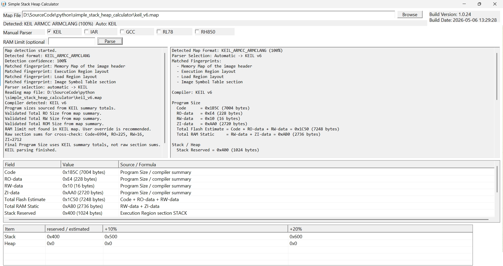

# Simple Stack Heap Calculator

Windows MFC utility for parsing embedded linker map files and estimating:

- `Code`
- `RO-data`
- `RW-data`
- `ZI-data`
- total flash usage
- static RAM usage
- stack / heap reserved or estimated size
- estimated RAM required
- RAM remaining and risk level

## Highlights

- Automatic map format detection based on content fingerprints
- Manual parser fallback selection in the UI
- Static MFC build for direct EXE delivery on target Windows PCs
- Build version and build date shown in the application
- Stack / heap recommendation table aligned to `0x100`

## Supported Map Formats

Detected formats:

- `KEIL_ARMCC_ARMCLANG`
- `GCC_GNU_LD`
- `IAR_ILINK`
- `RENESAS_CC_RL`
- `RENESAS_CC_RH`
- `GHS`
- `UNKNOWN`

Parsing coverage:

- `KEIL`: parsing
- `GCC`: parsing
- `IAR`: parsing
- `RL78 (CC-RL)`: partial parsing
- `RH850 (CC-RH)`: partial parsing
- `GHS`: detection only

## UI Behavior

- The tool does not assume every `.map` file is a KEIL map.
- Map format is detected automatically after a file is loaded.
- If detection confidence is high enough, the matching parser is selected automatically.
- If detection is weak or unknown, the manual parser selection is used as fallback.
- The app icon is shared across the title bar, taskbar, and File Explorer executable icon.
- User settings are stored in `SimpleStackHeapCalculator.ini` next to the EXE.

## Build

Use Visual Studio 2022 with MFC support installed, or run:

```powershell
.\scripts\build.ps1 -Configuration Release -Platform x64
```

Helper scripts:

```text
scripts\build_release.bat
scripts\clean_build.bat
scripts\build_release_mfc.bat
scripts\clean_mfc.bat
```

Build behavior:

- `scripts\build.ps1`
  - defaults to `Release|x64`
  - closes only the exact canonical output EXE before rebuild, normally first;
    same-named copies in other folders are not closed
  - launches `build\SimpleStackHeapCalculator.exe` unless `-NoRun` is used
- `scripts\build_release.bat`
  - builds `Release|x64`
  - closes only the exact canonical output before rebuild
  - relaunches the EXE after a successful build
- `scripts\clean_build.bat`
  - removes known compiler/linker intermediates only
  - preserves the EXE, portable INI, and other delivery/runtime files

Output:

```text
build\SimpleStackHeapCalculator.exe
build\SimpleStackHeapCalculator.ini
build\obj\<Platform>\<Configuration>\SimpleStackHeapCalculator.pdb
```

## Project Layout

```text
src\
  core\
  detector\
  generated\
  model\
  parser\
  ui\
  util\
scripts\
build\
```

## Notes

- RAM limit can be parsed from the map when the format provides enough memory-region information.
- If RAM limit cannot be determined automatically, enter it manually in the UI.
- Estimated RAM avoids double-counting stack or heap when they are already included in static RAM totals.
- The tool persists:
  - last map path
  - RAM limit text
- Manual parser always defaults to `KEIL` on startup
- If auto-detection finds a different compiler with enough confidence, the matching checkbox is highlighted with `[Auto]` until manual selection matches it


## Screen capture


